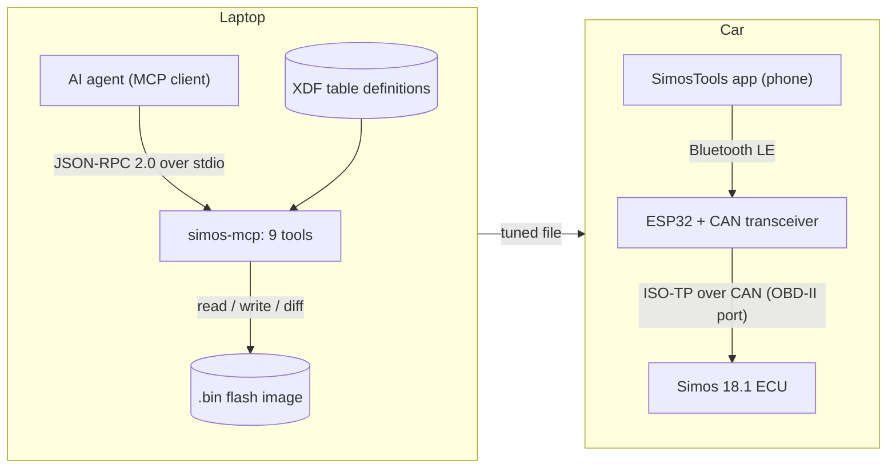
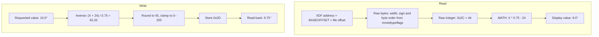
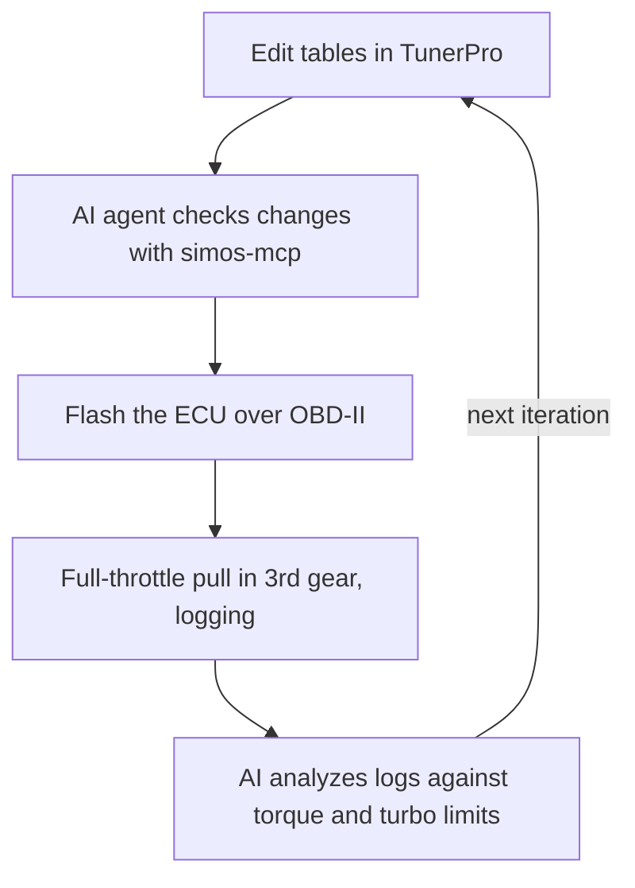

# ECU Calibration Toolkit
**July 2026 – August 2026**  
**ESP32 · CAN · Python · TunerPro XDF · MCP**

[GitHub](https://github.com/u759/simos-mcp)

**Overview**

- Built a tool to read, edit, and compare ECU tables by decoding TunerPro XDF mappings and reverse-engineering a 2015 VW GTI Simos 18.1 ECU to improve engine performance
- Built an ESP32 OBD-II adapter for CAN communication and high-speed logging (HSL) for data-driven tuning
- Handled base offsets, table endianness, and write saturation to avoid table overflow
- Exposed 9 read/write tools over JSON-RPC/stdio MCP for connecting to AI agents, with fuzzy table search and concise responses for token optimization

## Why I made this

The EA888 engine in my MK7 GTI is known to be detuned from the factory. Stock, it makes around 210 horsepower and 258 lb-ft of torque. But because I am a car enthusiast and am stupid, I wanted to make more horsepower.

Off-the-shelf engine control unit (ECU) tunes, often marketed as "Stage X" tunes, offer performance improvements by modifying preset "tables" in the engine mappings. For example, the "Torque to Airflow" (TTA) table converts the torque requested by your pedal position to a target cylinder airflow. By carefully modifying dependent tables within safe limits, you can achieve modest horsepower gains at the expense of more frequent maintenance.

Stage 1 tunes are designed to increase horsepower without hardware modifications, usually by increasing boost pressure in turbocharged cars. It is literally a software update. However, Stage 1 tunes are highly gatekept behind steep prices (usually $500), and each car, even of the same model, may have a slightly different ECU box code.

Because my car also has an automatic dual-clutch transmission, it has its own transmission control unit (TCU). Changes to ECU performance usually mandate a TCU update to avoid damage, which is yet another $500.

Suffice it to say, I sought to learn how to tune the car myself.

An open-source platform known as SimosTools exists to help people like me get into car tuning. You can build your own car adapter - known as an OBD-II dongle - using an ESP32 microcontroller and a CAN transceiver with [Bluetooth to ISOTP](https://github.com/Switchleg1/esp32-isotp-ble-bridge) firmware installed. This allows me to flash files from my mobile phone to the ESP32, which writes the file to the car via the CAN protocol. I built one with 20 dollars' worth of Amazon parts.

|  |  |
|---|---|

The actual firmware running on an ECU is a 4MB BIN file, which must be found online and decoded. Online communities have reverse-engineered these BIN files into editable tables using XDF mapping files, which you can edit in specialized software like TunerPro. I followed this path before I decided to make my own tuning software.

## My ECU Toolkit

I wanted a way to tune the ECU/TCU using AI models to validate my work. However, TunerPro has no way to expose the tables to AI agents. So I created a Python program to read the BIN files using the XDF. It exposes many tools, such as READ/WRITE/DIFF for BIN files, over JSON-RPC/stdio MCP so AI agents could work on the files directly. Each MCP tool returns only the information the AI agent needs and paginates long responses, like the list of tables, to avoid burdening the context. I also implemented a SEARCH tool, which uses fuzzy text matching to search for relevant tables.

There were many quirks, such as handling base offsets and endianness. Each table cell requires inverting the XDF mapping to convert display values (degrees, standard units) into raw integer values, since the BIN has to store small numbers for efficiency. I managed to read/edit each table and compare it to what TunerPro sees, both visually and through file hashing.

For example, one cell of an 8-bit timing table stored at 0.75° per count:

I followed some online tuning literature, made the changes in TunerPro, then asked my AI agent to use the MCP I built to validate my changes and optimize them if needed. After having a ready file, I flashed it to my car's ECU using the OBD-II dongle I built and performed a full-throttle pull in 3rd gear while logging all engine parameters. I then gave the logs to the AI agent and asked it to analyze them and suggest improvements, while specifying constraints such as maximum torque and turbo speed to avoid damaging anything. I had created an engineering loop with data-driven tuning and AI-assisted iterations.

Multiple iterations later, I had a car that was producing ~25% more horsepower than stock, within the range of standard Stage 1 tunes.

Now I just have to do the same with the TCU.

**TODO**
- [ ] Pull log plot (stock vs tuned)
- [ ] Hardware photo
- [ ] Before/after table
- [ ] Real cell in byte diagram
- [ ] Car photo
- [ ] Dyno or "estimated" caption
- [ ] Make sure tune doesn't explode engine